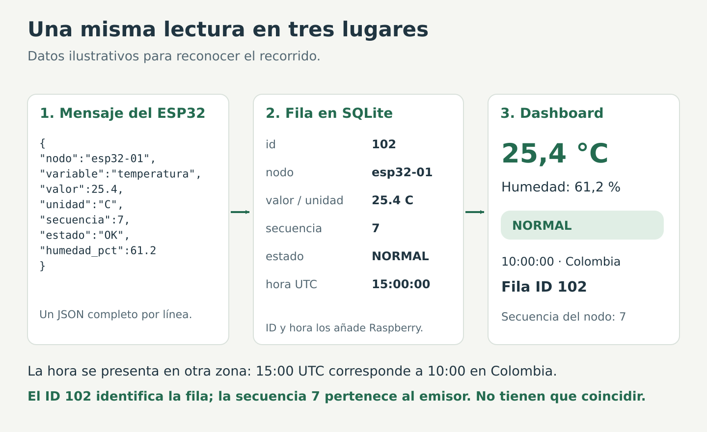
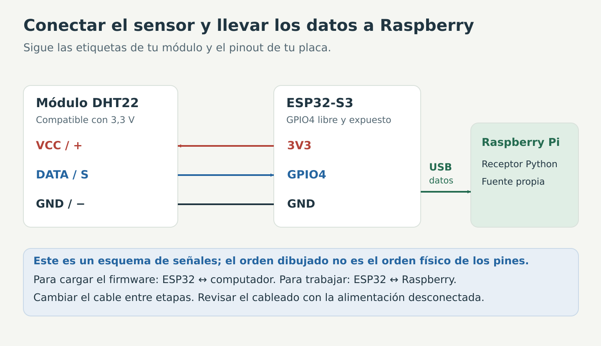
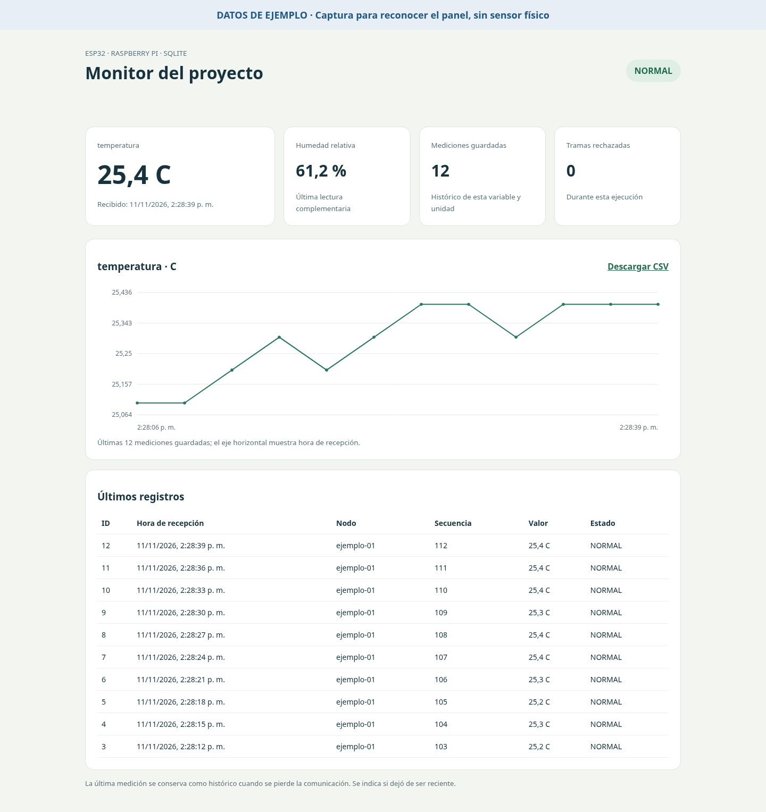

# Lectura de sensores con ESP32 y Raspberry Pi

En esta práctica construiremos un monitor de temperatura y humedad. El ESP32 toma la lectura del sensor, la envía por USB y la Raspberry la guarda y la presenta en una página.

Imagina que quieres saber cómo cambia la temperatura del salón durante una jornada. Mirar una cifra ahora no permite recordar lo que ocurrió antes. Vamos a dejar un registro que se pueda revisar después y un panel para ver las últimas lecturas.

El dibujo utiliza valores de ejemplo. En la práctica se trabaja con las lecturas del sensor.

~~~text
Sensor DHT22 → ESP32 → USB → Programa Python → SQLite → Dashboard
~~~

Al finalizar debemos poder seguir una misma lectura desde el mensaje del ESP32 hasta la fila de la base de datos y el valor mostrado en pantalla.

## Por dónde empezar

Para seguir los pasos necesitas ver el escritorio de Raspberry, poder abrir su navegador y disponer del módulo DHT22 indicado en materiales. Si todavía no llegas al escritorio, completa primero [la preparación del equipo](preparacion.md).

Usa esta página como recorrido de trabajo. El [marco teórico](marco-teorico.md) explica por qué hacemos cada parte y el [glosario](glosario.md) aclara las palabras enlazadas.

| Tramo | Qué debe funcionar antes de seguir |
|---|---|
| Pasos 1 a 4 | El Monitor serial muestra lecturas del sensor |
| Pasos 5 a 9 | Raspberry recibe mensajes y el dashboard abre |
| Pasos 10 a 12 | Puedes consultar una fila y explicar su estado |
| Pasos 13 y 14 | Puedes mostrar qué ocurre ante un error o una desconexión |
| Paso 15 | El receptor vuelve a funcionar después de reiniciar Raspberry |

## Los conceptos que vamos a utilizar

| Concepto | Significado |
|---|---|
| Sensor | Dispositivo que obtiene una lectura de una magnitud física |
| Firmware | Programa cargado en el ESP32 |
| Puerto serial | Canal por el que intercambiamos mensajes con la placa |
| JSON | Forma de organizar los campos de un mensaje |
| SQLite | Motor que guarda y consulta los registros en un archivo local |
| SQL | Lenguaje de las instrucciones que enviamos a la base de datos |
| Flask | Herramienta Python que atiende las peticiones de la página |
| Dashboard | Panel con valores, estados, gráfica y registros |

**SQLite guarda; el dashboard presenta.** Cerrar la página no borra el histórico. El programa receptor debe seguir funcionando para recibir nuevas lecturas.

El [marco teórico de SQLite y dashboard](marco-teorico.md) incluye ejemplos de tablas, consultas y estados para acompañar los pasos.

Para profundizar, consultar [bases de datos: SQL, SQLite y MySQL](bases-de-datos.md). Las palabras clave se explican en un [glosario con ejemplos](glosario.md).

## Dónde haremos cada cosa

| Acción | Equipo o aplicación |
|---|---|
| Editar y cargar el firmware | Arduino IDE en el computador |
| Conectar el sensor | Pines del ESP32, con alimentación desconectada |
| Preparar y ejecutar Python | Terminal de la Raspberry |
| Guardar la base de datos | Carpeta del programa en la Raspberry |
| Abrir el dashboard | Navegador dentro del escritorio de la Raspberry |
| Controlar ese escritorio desde el Mac | Raspberry Pi Connect |

La terminal del Mac y la terminal del escritorio de Raspberry pertenecen a equipos distintos. En las instrucciones se indica cuál utilizar.

Cuando veas jancome@RaspberryJC o (.venv) antes de un comando, son indicaciones de la terminal: no se escriben. Copia solo las líneas del bloque. Ejecutar significa pegarlas y pulsar Enter.

Para pasar texto del Mac al escritorio remoto, utiliza **Paste to remote / Pegar en remoto** en la barra de Connect. Después, si hace falta pegar en la terminal de Raspberry, utiliza Ctrl+Shift+V. Ctrl+C en una terminal detiene el programa que está corriendo.

## Materiales

- Raspberry Pi con Raspberry Pi OS, fuente, refrigeración y acceso al escritorio.
- ESP32-S3 y cable USB que permita **datos**, no solo carga.
- DHT22 en **módulo de tres pines**, con pull-up integrado y funcionamiento confirmado a 3,3 V.
- Cables para conectar el módulo al ESP32.
- Arduino IDE y los archivos de la práctica.

El DHT22 mide temperatura ambiente y humedad. No mide la temperatura interna del procesador de Raspberry.

Un sensor suelto de cuatro pines puede requerir una resistencia externa. Revisar las etiquetas del módulo; el orden de sus conexiones varía. N16R8 identifica memoria del módulo ESP32, no el nombre completo ni el pinout de la placa.

## 1. Descargar los archivos

Haz la descarga en el computador y también en el navegador **del escritorio de Raspberry**. En ambos, abrir [Sistemas-Embebidos](https://github.com/jancome/Sistemas-Embebidos), pulsar **Code → Download ZIP** y descomprimir. Descargarlo solo en el Mac no lo copia automáticamente a Raspberry.

Dentro de la carpeta descargada buscar:

~~~text
guias-laboratorio/
  lab-10-uart-esp32-raspberry/
    integracion-usb-dashboard/
~~~

Se necesita una copia en el computador para cargar el firmware y otra en Raspberry para ejecutar el receptor.

En Raspberry:

1. Abrir el explorador de archivos con el icono de carpeta.
2. Entrar a Downloads / Descargas y extraer el ZIP si aún no está extraído.
3. Seguir la ruta anterior hasta integracion-usb-dashboard.
4. Copiar esa carpeta completa.
5. Abrir Home / Carpeta personal y pegarla allí.
6. Cambiar su nombre a **monitor_esp32**.

Así utilizaremos una ruta sencilla:

~~~text
/home/tu_usuario/monitor_esp32
~~~

En tu equipo el usuario puede ser diferente. El símbolo ~ en la terminal representa la carpeta personal y evita tener que escribir ese nombre.

La carpeta debe contener:

~~~text
monitor_esp32/
  app.py
  config.json
  requirements.txt
  ejemplo_sqlite.py
  consultar_datos.py
  consultas_guiadas.py
  generar_servicio.py
  marco-teorico.md
  bases-de-datos.md
  glosario.md
  preparacion.md
  imagenes/
  templates/
    dashboard.html
  esp32_dht22/
    esp32_dht22.ino
~~~

No separar dashboard.html de la carpeta templates: el servidor utiliza esa ubicación.

## 2. Preparar Arduino IDE en el computador

Si la placa ya puede programarse, conservar su configuración y comprobar las bibliotecas del sensor.

Para una instalación inicial:

1. Instalar [Arduino IDE](https://www.arduino.cc/en/software).
2. Abrir **Preferencias** y localizar **Gestor de URLs adicionales de tarjetas**.
3. Añadir la dirección estable del soporte ESP32:

   ~~~text
   https://espressif.github.io/arduino-esp32/package_esp32_index.json
   ~~~

4. Abrir **Gestor de placas**, buscar esp32 e instalar el paquete de **Espressif Systems**.
5. Seleccionar la placa correspondiente. En algunas placas genéricas aparece ESP32S3 Dev Module; comprobar el modelo y las opciones del fabricante.
6. En **Gestor de bibliotecas**, buscar e instalar **DHT sensor library by Adafruit**. Instalar también **Adafruit Unified Sensor** si el gestor no la incorpora como dependencia.

Estas bibliotecas van en Arduino IDE. No se instalan con pip: pip se utilizará después para las dependencias de Python en Raspberry.

La identificación de la placa, las descargas y la carga del firmware deben comprobarse antes de montar el sistema completo.

## 3. Conectar el módulo DHT22 al ESP32

Desconectar la alimentación antes de cablear. Seguir las etiquetas:

El dibujo muestra las señales, no la posición física de los pines. Identifica las etiquetas en tu módulo y en el pinout de tu placa.

| DHT22 | ESP32-S3 | Función |
|---|---|---|
| VCC / + | 3V3 | Alimentación |
| GND / − | GND | Referencia eléctrica común |
| DATA / S | GPIO4, si está expuesto y libre en la placa | Lectura digital |

[GPIO4](glosario.md#gpio-pullup) es el identificador del ESP32, no el cuarto pin del conector de Raspberry. Si se utiliza otro GPIO disponible, cambiar PIN_DHT en el firmware.

En este montaje el sensor se alimenta a 3,3 V y su módulo debe ser compatible con ese voltaje. No conectar una señal de 5 V directamente al ESP32. El YF-S201 necesita un montaje de adaptación distinto y no se sustituye directamente por este módulo.

**Resultado que comprobar:** conexiones según etiquetas, alimentación adecuada y pin de datos coincidente con el código.

## 4. Cargar el firmware y observar el mensaje

1. Conectar el ESP32 al computador mediante el USB de datos.
2. Abrir [esp32_dht22.ino](esp32_dht22/esp32_dht22.ino).
3. Seleccionar placa y puerto en Arduino IDE.
4. Cargar el programa y esperar el mensaje de carga terminada.
5. Abrir **Monitor serial** y seleccionar **115200 baudios**.

Baudios es la velocidad configurada para la comunicación serial. El emisor y el receptor deben usar la misma.

El Monitor serial es una ventana de Arduino IDE para ver lo que envía la placa. En el ESP32-S3 puede haber dos conectores USB con funciones distintas: identifica el que corresponde a la placa elegida y utiliza el que ya permitió cargar y ver mensajes.

Si la placa utiliza USB nativo, puede requerir **USB CDC On Boot → Enabled** para que Serial salga por ese conector. Si usa un puente USB-UART, la configuración debe corresponder a ese puente. Consultar el manual de la placa y utilizar después el mismo conector que funcionó.

El programa consulta el DHT22 cada tres segundos. Debe aparecer un mensaje por línea, por ejemplo:

~~~json
{"nodo":"esp32-01","variable":"temperatura","valor":25.4,"unidad":"C","secuencia":1,"estado":"OK","humedad_pct":61.2}
~~~

Los números anteriores son ilustrativos; el monitor debe mostrar las lecturas de tu sensor.

| Campo | Cómo interpretarlo |
|---|---|
| nodo | Identifica al emisor |
| variable | Indica qué representa valor |
| valor | Lectura numérica |
| unidad | C corresponde a grados Celsius |
| secuencia | Contador del mensaje desde el arranque |
| estado | OK si el firmware obtuvo lectura; ERROR si no pudo |
| humedad_pct | Lectura complementaria de humedad relativa |

JSON permite organizar esos campos; USB lleva el mensaje. El salto de línea indica dónde termina.

**Resultado que comprobar:** líneas legibles, secuencia que aumenta y valores reales. Si el sensor no responde, se envía ERROR y valor null; no se inventa una lectura de cero.

Si hay ERROR, revisar alimentación, módulo/pull-up y coincidencia del GPIO. No continuar con Raspberry hasta tener identificada la lectura.

Para reconocer las instrucciones del firmware:

~~~cpp
constexpr uint8_t PIN_DHT = 4;             // GPIO utilizado por DATA
constexpr uint32_t INTERVALO_MS = 3000;    // Tres segundos entre lecturas
DHT dht(PIN_DHT, DHT22);                   // Sensor que se va a consultar
~~~

En setup, Serial.begin(115200) prepara la comunicación y dht.begin() inicializa el sensor. setup se ejecuta una vez al arrancar. loop se repite: espera el intervalo, pide temperatura y humedad, comprueba si hubo fallo y envía el JSON. millis() informa el tiempo transcurrido desde el arranque; no es la fecha del calendario.

3000 milisegundos equivalen a tres segundos porque un segundo contiene 1000 milisegundos. Es el mismo tipo de conversión de unidades que utilizamos al pasar de miligramos a gramos.

Estas dos instrucciones obtienen los valores:

~~~cpp
const float temperatura = dht.readTemperature();  // Temperatura en Celsius
const float humedad = dht.readHumidity();         // Humedad relativa en %
~~~

Son fragmentos del programa completo, no otro firmware que haya que cargar por separado. Primero se comprueba la lectura y después se estudia cómo se forma el mensaje con Serial.printf.

Cerrar el Monitor serial. Desconectar el ESP32 del computador antes de pasarlo a la Raspberry.

## 5. Abrir la carpeta en la terminal de Raspberry

Conectar el ESP32 a un puerto USB de Raspberry. Si utilizas Connect, abre la terminal con el icono >_ **dentro de ese escritorio**.

Ejecutar una línea y pulsar Enter antes de pasar a la siguiente:

~~~bash
cd ~/monitor_esp32
pwd
ls
~~~

- cd entra a la carpeta.
- pwd muestra la ubicación actual.
- ls muestra sus archivos.

**Resultado que comprobar:** pwd termina en monitor_esp32 y ls incluye app.py, config.json y requirements.txt.

Si aparece No such file or directory, revisar dónde se copió la carpeta y respetar mayúsculas. No seguir instalando desde una carpeta equivocada.

## 6. Crear el entorno Python

Un [entorno virtual](glosario.md#entorno-virtual) guarda las bibliotecas Python del proyecto. Desde esa carpeta:

~~~bash
python3 -m venv .venv
source .venv/bin/activate
python -m pip install -r requirements.txt
~~~

| Instrucción | Qué hace |
|---|---|
| python3 -m venv .venv | Crea un entorno de Python para este proyecto |
| source .venv/bin/activate | Hace que la terminal utilice ese entorno |
| python -m pip install -r requirements.txt | Instala las dependencias indicadas en el archivo |

El entorno evita mezclar las bibliotecas de la práctica con las del sistema. requirements.txt incluye Flask y pySerial.

Puedes pensar en .venv como la caja de herramientas de este proyecto: activar la caja hace que esta terminal utilice las bibliotecas que guardamos allí. Al abrir otra terminal, hay que activarla otra vez.

**Resultado que comprobar:** la instalación termina sin errores y la terminal suele mostrar (.venv) al inicio.

Si Python indica que falta venv:

~~~bash
sudo apt install python3-venv
~~~

Después repetir la creación. En una terminal nueva hay que volver a entrar a la carpeta y activar .venv.

Para esta aplicación se recomienda editar en Thonny o en un editor y **ejecutar desde la terminal con el entorno activo**. El botón Run de Thonny puede utilizar otro intérprete sin las dependencias instaladas.

## 7. Identificar el puerto del ESP32

~~~bash
python -m serial.tools.list_ports -v
~~~

La instrucción lista los dispositivos seriales. Puede aparecer /dev/ttyACM0 o /dev/ttyUSB0; son ejemplos de nombres, no valores que deban asumirse en todos los equipos.

**Resultado que comprobar:** aparece el dispositivo correspondiente al ESP32.

Si no aparece, comprobar cable de datos y conector/configuración USB. No abrir el monitor de Arduino mientras el receptor utiliza ese puerto.

Si aparece Permission denied:

~~~bash
groups
~~~

Si falta dialout, agregar al usuario propio:

~~~bash
sudo usermod -aG dialout "$USER"
~~~

Cerrar sesión y volver a entrar para actualizar los grupos; reiniciar ordenadamente es otra opción. No ejecutar toda la aplicación con sudo ni cambiar permisos globales del puerto.

## 8. Entender config.json

Abrir config.json con un editor. Contiene:

~~~json
{
  "puerto": "auto",
  "baudrate": 115200,
  "variable": "temperatura",
  "unidad": "C",
  "minimo": -40,
  "maximo": 80,
  "umbral": null,
  "sin_datos_s": 10
}
~~~

| Parámetro | Significado |
|---|---|
| puerto | auto busca un único USB; también acepta la ruta identificada en el paso anterior |
| baudrate | Debe coincidir con Serial.begin del ESP32 |
| variable y unidad | Deben coincidir exactamente con el mensaje |
| minimo y maximo | Rango aceptado para esa variable y sensor |
| umbral | Condición didáctica: si valor >= umbral se clasifica ALERTA |
| sin_datos_s | Tiempo máximo antes de considerar que falta una lectura válida reciente |

null significa que no hay umbral configurado; en ese caso no se aplica una condición de alerta. No es cero.

El rango -40 a 80 se utiliza para validar este ejemplo de temperatura DHT22; no significa que todos esos valores sean seguros para un proceso.

Si hay varios USB, auto no elige uno al azar. Escribir la ruta identificada. Si existe una identificación persistente en /dev/serial/by-id, también puede utilizarse.

Guardar después de editar. El archivo JSON usa comillas dobles y no admite comentarios con #.

Para editarlo desde el escritorio, busca config.json en monitor_esp32 y ábrelo con un editor de texto. También puedes usar Thonny, Archivo → Abrir, seleccionando todos los archivos si no aparece JSON. Guarda con Ctrl+S. Los fragmentos explicativos de esta guía no se pegan completos encima del programa.

## 9. Ejecutar el receptor y abrir la página

Con la terminal en monitor_esp32 y .venv activo:

~~~bash
python app.py
~~~

La aplicación abre el puerto, espera mensajes, valida, guarda registros y atiende la página. Dejar esa terminal abierta.

Abrir el navegador **de la Raspberry** y escribir:

~~~text
http://127.0.0.1:5000
~~~

127.0.0.1 significa el mismo equipo donde está abierto el navegador. Por eso, si estás usando Connect, la dirección se escribe dentro del navegador del escritorio remoto. En el navegador del Mac consultaría al Mac.

**Resultado que comprobar:** se abre el dashboard. Al llegar mensajes válidos aparecen temperatura, humedad, hora y registros. La cantidad guardada debe aumentar.

La página se actualiza cada dos segundos y el sensor se consulta cada tres. Actualizar la página no obliga a obtener otra lectura. Los cambios del DHT22 pueden tardar en reflejarse.

Antes de seguir, observa al menos diez registros: la hora o la secuencia deben avanzar aunque la temperatura se mantenga igual. Un salón estable puede producir muchas lecturas con el mismo valor; eso no implica que el programa esté detenido.

## 10. Aprender SQLite con un ejemplo separado

Dejar la primera terminal con app.py funcionando. Abrir una **segunda terminal de Raspberry** y ejecutar:

~~~bash
cd ~/monitor_esp32
source .venv/bin/activate
python ejemplo_sqlite.py
~~~

Este ejemplo crea **ejemplo.sqlite3**, añade un dato ilustrativo y lo consulta. No escribe ese dato en mediciones.sqlite3.

Abrir [ejemplo_sqlite.py](ejemplo_sqlite.py) y seguir estas operaciones:

| Parte del código | Función |
|---|---|
| sqlite3.connect | Abre o crea la base |
| CREATE TABLE IF NOT EXISTS | Define la tabla si todavía no existe |
| INSERT INTO | Añade una fila |
| commit | Confirma la operación de escritura |
| SELECT | Recupera filas |
| fetchall | Obtiene los resultados de la consulta |

**Resultado que comprobar:** aparece un identificador, una fecha y el valor ilustrativo. Ejecutar de nuevo añade otra fila; no es una nueva medición física.

La explicación completa de tabla, fila, columna, SQL y transacción está en el [marco teórico](marco-teorico.md).

## 11. Consultar los registros reales

Mantener app.py ejecutándose en la primera terminal. En la segunda terminal utilizada en el paso anterior:

~~~bash
cd ~/monitor_esp32
source .venv/bin/activate
python consultar_datos.py
~~~

[consultar_datos.py](consultar_datos.py) muestra cantidad de mediciones, últimas filas y eventos. Comprueba que existe la base antes de abrirla para evitar crear por accidente un archivo vacío en otra carpeta.

Para explorar filtros, alertas, cantidad de filas y resúmenes por nodo, ejecutar también:

~~~bash
python consultas_guiadas.py
~~~

Muestra cada instrucción, sus parámetros y su resultado. Abre la base en modo de solo lectura. Si no hay alertas o el filtro no encuentra registros, puede mostrar que no hay filas; no genera datos para completar el ejemplo.

El [capítulo de bases de datos](bases-de-datos.md) explica cómo pasar de la pregunta a la consulta y cómo interpretar cada resultado.

La consulta principal es:

~~~sql
SELECT id, fecha_hora, nodo, valor, unidad, estado, humedad_pct
FROM mediciones
ORDER BY id DESC
LIMIT 5;
~~~

Se lee: “mostrar estos campos de la tabla mediciones, empezando por los id mayores y devolver como máximo cinco filas”.

Para comprobar una lectura concreta:

1. En la tabla **Últimos registros** del dashboard, elige una fila y anota su **ID**, nodo, secuencia, valor y hora.
2. En la segunda terminal, consulta ese ID. Si elegiste 12:

   ~~~bash
   python consultas_guiadas.py --id 12
   ~~~

3. Sustituye 12 por el ID que realmente anotaste. Compara los campos de esa fila.

La consulta por ID evita que la comparación dependa del último número de la tarjeta, que puede cambiar mientras escribes. La base guarda UTC y la página convierte la hora a la zona del navegador; 15:00 UTC corresponde a 10:00 en Colombia.

El ID pertenece a la base. La secuencia pertenece al ESP32. Pueden ser distintos aunque describan la misma recepción.

mediciones.sqlite3 es un archivo de base de datos, no un texto para editar directamente. Los archivos con sufijos -wal y -shm que puedan aparecer son auxiliares de SQLite; no borrarlos mientras la aplicación funciona.

## 12. Interpretar el dashboard

Esta captura usa datos de prueba. En tu pantalla deben aparecer el nodo y las mediciones de tu montaje.

| Elemento | Qué responde |
|---|---|
| Valor y humedad | ¿Cuál fue la última medición guardada? |
| Hora de recepción | ¿Cuándo llegó? |
| Estado | ¿Hay datos recientes o una condición que atender? |
| Gráfica | ¿Cómo cambió la variable en el histórico reciente? |
| Tabla | ¿Cuáles son los últimos registros? |
| Descargar CSV | ¿Cómo obtengo una copia tabular para analizar o entregar? |

La página solicita información a /api/estado. Python consulta SQLite y devuelve un resumen; la página lo representa. El navegador no lee el archivo SQLite directamente.

**Importante:** una lectura antigua visible no equivale a un sensor conectado ahora. Revisar hora y estado, no solo el número.

### Comprobar NORMAL y ALERTA

La configuración inicial tiene umbral null, por eso no crea alertas por temperatura. Para probar la regla sin calentar nada:

1. Mira la temperatura actual. Supongamos que está alrededor de 25 °C.
2. En la primera terminal, detén app.py con Ctrl+C.
3. Abre config.json y cambia **solo el valor** de umbral a 24. Conserva la coma que ya tenía esa línea:

   ~~~json
   "umbral": 24,
   ~~~

4. Guarda y ejecuta otra vez python app.py.
5. Cuando llegue una lectura válida de al menos 24 °C, el panel debe mostrar ALERTA.
6. Repite la edición con un umbral superior a la lectura, por ejemplo 35 si el sensor sigue cerca de 25 °C. Detén, guarda y vuelve a ejecutar: las nuevas lecturas menores que 35 se clasifican NORMAL.
7. Al terminar, decide y documenta el umbral del ensayo o restaura null.

Elige números adecuados a la lectura que estás viendo; 24 y 35 son ejemplos. La regla es valor >= umbral. Una alerta en este ensayo significa que se cumplió esa regla, no que exista daño.

Cambiar config.json mientras app.py sigue abierto no recarga los parámetros. Hay que reiniciar la aplicación. Las filas anteriores conservan el estado y el umbral con que se guardaron.

## 13. Probar una trama incorrecta

1. En la primera terminal, detener app.py con Ctrl+C. Si se utiliza como servicio, detenerlo con sudo systemctl stop monitor-esp32.
2. Cerrar cualquier monitor serial.
3. Pasar el ESP32 al computador y abrir el firmware.
4. Cambiar la línea del indicador de prueba a:

   ~~~cpp
   constexpr bool PROBAR_TRAMA_INVALIDA = true;
   ~~~

5. Cargar el firmware, cerrar el monitor y volver a conectar ESP32 a Raspberry.
6. Ejecutar otra vez el receptor. Si el indicador todavía está en false, este paso no provoca una trama incorrecta.
7. Cuando el receptor ya esté abierto, pulsar una vez RESET en el ESP32 para repetir la secuencia de prueba. Esperar a que reabra el puerto si es necesario.

En la segunda adquisición se envía un JSON sin los campos requeridos. La lectura no debe guardarse como una medición válida. El contador de rechazadas y la tabla eventos permiten comprobarlo. Las siguientes lecturas vuelven al recorrido normal.

**Evidencia:** captura del contador y consulta del evento. Identificar que el fallo fue inducido. Restaurar false y volver a cargar al finalizar.

La prueba no significa que el sensor se dañó ni que el mensaje fuera una medición real de cero.

## 14. Probar desconexión y recuperación

1. Mantener el dashboard y app.py abiertos.
2. Desconectar solo el USB entre ESP32 y Raspberry.
3. Esperar más de diez segundos, el plazo sin_datos_s de la configuración inicial, y otra actualización de pantalla.
4. Observar el estado y el último registro.
5. Conectar otra vez el cable de datos.
6. Esperar que el receptor reintente y aparezcan filas nuevas.

**Resultado esperado:** el dato anterior permanece como histórico; no se insertan ceros por falta de comunicación. La página indica que no hay datos recientes y vuelve a actualizarse al recibir lecturas válidas.

Abrir el puerto puede reiniciar algunas placas. La secuencia del ESP32 puede comenzar de nuevo, pero el id de SQLite y las filas anteriores no se borran.

No se reconstruyen mediciones que nunca llegaron. Para recuperarlas harían falta almacenamiento temporal y reenvío en el nodo, fuera del alcance de esta implementación.

## 15. Configurar inicio automático

Hacerlo después de comprobar la ejecución manual. Un servicio permite que Linux inicie la aplicación sin abrir una terminal después de cada reinicio.

Detener app.py con Ctrl+C y, desde la carpeta y el entorno, ejecutar:

~~~bash
python generar_servicio.py
~~~

El programa crea monitor-esp32.service usando el usuario y las rutas de ese equipo. Ejecutar el generador como usuario normal.

Instalar el servicio:

~~~bash
sudo cp monitor-esp32.service /etc/systemd/system/
sudo systemctl daemon-reload
sudo systemctl enable --now monitor-esp32
systemctl status monitor-esp32 --no-pager
~~~

| Instrucción | Función |
|---|---|
| cp | Copia la definición al directorio de servicios |
| daemon-reload | Pide a systemd volver a leer las definiciones |
| enable --now | Lo habilita para el arranque y lo inicia ahora |
| status | Consulta si está funcionando |

Buscar active (running) en el estado. Abrir el dashboard y comprobar nuevas lecturas.

Para reiniciar después de editar configuración:

~~~bash
sudo systemctl restart monitor-esp32
~~~

Para consultar los últimos mensajes:

~~~bash
journalctl -u monitor-esp32 -n 30 --no-pager
~~~

Los logs describen la operación y los fallos; no son la tabla de mediciones. No ejecutar a la vez el servicio y otra copia manual de app.py.

Finalmente reiniciar Raspberry de forma ordenada y comprobar que el receptor vuelve a recibir sin abrir la terminal. No reiniciar mientras se instalan actualizaciones.

~~~bash
sudo reboot
~~~

Connect se desconectará durante el reinicio. Vuelve a entrar cuando el dispositivo esté disponible y abre el navegador de Raspberry en la misma dirección del dashboard.

Si necesitas regresar al trabajo manual, detén primero el servicio:

~~~bash
sudo systemctl stop monitor-esp32
~~~

Esto no lo deshabilita para el siguiente arranque. Si también quieres quitar su inicio automático, utiliza sudo systemctl disable monitor-esp32.

## Evidencias del informe

Entregar según las condiciones de la tarea:

1. Diagrama y conexiones identificadas.
2. Un mensaje real y explicación de sus campos.
3. Código ESP32 y Python con los cambios del grupo.
4. Consulta SQLite y registro correspondiente en el dashboard.
5. Exportación CSV del histórico.
6. Trama incorrecta rechazada.
7. Desconexión, reconexión y arranque automático.
8. Logs relevantes y explicación de las dificultades.

En el informe, sigue una lectura de principio a fin: incluye el mensaje y una fila del panel, consulta su ID y explica qué significan sus campos. Después muestra una condición NORMAL, una ALERTA y una interrupción identificando lo que hiciste en cada caso. Una captura sin explicación no permite saber si el dato era actual o histórico.

Cada conclusión debe señalar **acción, resultado observado y evidencia**. Por ejemplo: “desconectamos USB, el panel cambió de estado y el contador dejó de aumentar; al reconectarlo se añadieron filas nuevas”. Esto no demuestra recuperación de las lecturas perdidas.

Para obtener una copia consistente de la base mientras se utiliza, se puede usar el método backup de SQLite. Para la entrega habitual basta la exportación CSV y las consultas/capturas indicadas; no borrar archivos auxiliares de una base activa.

Se mantienen los demás requisitos del proyecto final, incluidos firmware modular/FreeRTOS y actuador o indicador, según el alcance acordado.

## Preguntas para revisar lo aprendido

Antes de entregar, intenta responderlas mirando tu propio montaje:

1. Si cierras Connect en el computador, ¿qué tendría que seguir encendido para continuar guardando?
2. ¿Dónde se ejecuta el programa que crea el JSON y dónde se guarda SQLite?
3. ¿Por qué el ID de una fila puede ser distinto de la secuencia del ESP32?
4. Si hay una lectura visible pero su hora no avanza, ¿qué revisarías antes de considerarla actual?
5. ¿Por qué cambiar el umbral puede producir una alerta sin cambiar el sensor?

Comprobar el razonamiento

1. Raspberry y ESP32 deben seguir alimentados y conectados, y el receptor debe continuar ejecutándose. Cerrar Connect no detiene por sí mismo la aplicación.
2. El firmware crea el JSON en el ESP32. El receptor de Raspberry guarda los registros en la base local.
3. SQLite asigna el ID a la fila; el ESP32 genera su contador desde el arranque.
4. Revisaría estado, hora de recepción, conexión USB y ejecución del receptor. El número puede pertenecer al histórico.
5. ALERTA es el resultado de comparar una lectura válida con una regla configurada; en esta prueba no representa una temperatura de daño.

## Revisar problemas frecuentes

| Mensaje o síntoma | Cómo revisarlo |
|---|---|
| No such file or directory al usar cd | Confirmar ruta, nombre y mayúsculas de la carpeta |
| No module named flask o serial | Activar .venv e instalar requirements.txt; ejecutar desde esa terminal |
| No aparece puerto | Comprobar cable, conector de placa y CDC/puente USB-UART |
| Permission denied | Revisar dialout y actualizar la sesión |
| ERROR del DHT22 | Revisar módulo, alimentación, pull-up y pin, con corriente desconectada al cambiar cables |
| Tramas rechazadas | Comparar mensaje con variable, unidad, campos y rango de config.json |
| Página no abre | Confirmar que app.py corre y que se usa el navegador de Raspberry |
| Address already in use | Otra aplicación ya utiliza el puerto; revisar servicio o copia manual |
| Histórico sin datos nuevos | Consultar estado del puerto, antigüedad de lectura y eventos |
| Error SQLite de escritura | Revisar logs, permisos y espacio disponible |
| No cambia a ALERTA | Confirmar un umbral numérico, compararlo con la lectura y reiniciar app.py después de guardar |
| La hora de la consulta difiere cinco horas | Comparar zona UTC de la base con la hora local del navegador |
| La consulta por ID no encuentra la fila | Usar el ID de SQLite, no la secuencia del ESP32, y comprobar que es la misma carpeta/base |

## Referencias

- [Marco teórico: SQLite y dashboard](marco-teorico.md).
- [Bases de datos: argumentos y consultas explicadas](bases-de-datos.md).
- [Glosario de términos](glosario.md).
- [Instalación de ESP32 en Arduino IDE](https://docs.espressif.com/projects/arduino-esp32/en/latest/installing.html).
- [DHT22](https://learn.adafruit.com/dht/overview) y [pull-up/conexión](https://learn.adafruit.com/dht/connecting-to-a-dhtxx-sensor).
- [Python sqlite3](https://docs.python.org/3/library/sqlite3.html).
- [Flask](https://flask.palletsprojects.com/en/stable/quickstart/).
- [pySerial](https://pyserial.readthedocs.io/en/latest/shortintro.html).
- [Laboratorio 10](../README.md), [laboratorio 11](../../lab-11-sqlite-dashboard-servicio/README.md), [proyecto final](../../../PROYECTO_FINAL.md).

