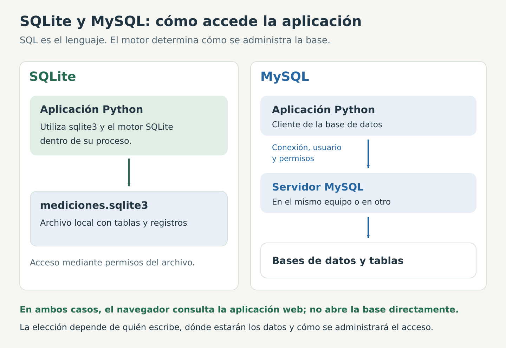

# Bases de datos para el proyecto: SQL, SQLite y MySQL

Esta lectura desarrolla la parte de almacenamiento del [marco teórico](marco-teorico.md). Los términos enlazados llevan al [glosario](glosario.md).

## Por qué el proyecto necesita un histórico

Imaginemos que un sensor envía 25,4 °C y el dashboard muestra ese valor. Podemos afirmar que existe una lectura visible. Para explicar cómo cambió la temperatura, necesitamos más información: qué se recibió antes, en qué momento y de qué equipo.

El histórico permite pasar de mostrar una cifra a responder preguntas:

| Situación del proyecto | Información necesaria | Uso del histórico |
|---|---|---|
| El valor aumentó | Lecturas ordenadas de un mismo nodo | Comparar antes y después |
| Se activó una alerta | Valor, unidad y umbral aplicado | Identificar la lectura que cumplió la regla |
| Se perdió la comunicación | Última recepción y eventos | Ubicar la interrupción y la reanudación |
| Se necesita un informe | Registros seleccionados | Contar, resumir y exportar datos |

Sin guardar registros, una pantalla que se actualiza sustituye lo que veíamos antes. Guardar solo el último valor tampoco permite reconstruir su evolución.

Una base de datos aporta organización y consultas. No demuestra por sí sola que el sensor sea preciso: una medición incorrecta también podría quedar almacenada si el receptor no la valida.

Una comparación cotidiana es la planilla de asistencia: podemos contar cuántos estudiantes llegaron o buscar solo los de un grupo sin volver a preguntar a todo el salón. Con las mediciones ocurre lo mismo: consultamos lo que ya quedó registrado.

## SQL, SQLite y MySQL: qué cambia entre ellos

[SQL](glosario.md#sql) es el lenguaje de las instrucciones. [SQLite](glosario.md#sqlite) y [MySQL](glosario.md#mysql) son motores que permiten utilizar ese lenguaje. No se instala «SQL» como si fuera el nombre de una aplicación única.

### Cómo funciona SQLite en esta práctica

~~~text
Programa Python en Raspberry
          ↓ utiliza sqlite3
Motor SQLite
          ↓ lee y escribe
Archivo mediciones.sqlite3
~~~

La aplicación abre un archivo local mediante el módulo sqlite3. No necesita conectarse a un servicio de base de datos independiente. El sistema operativo controla los permisos de acceso al archivo.

Esto ayuda en el montaje porque:

1. **Reduce la preparación inicial.** La práctica no añade cuentas ni configuración de otro servidor.
2. **Mantiene los datos junto al receptor.** Se conoce dónde queda el histórico, aunque se cierre el navegador.
3. **Permite consultar mientras se adquiere.** El receptor guarda y la aplicación web consulta; SQLite coordina el acceso.
4. **Permite formular preguntas nuevas.** Puede cambiarse una consulta sin modificar el sensor ni su firmware.

Estas ventajas corresponden a un histórico local utilizado por nuestra aplicación. La elección debe revisarse si cambian los requisitos. [Usos y criterios de selección de SQLite](https://www.sqlite.org/whentouse.html).

### Cómo sería una arquitectura con MySQL

~~~text
Aplicación Python
          ↓ conexión y credenciales
Servidor MySQL
          ↓ administra
Bases de datos, tablas y permisos
~~~

El servidor puede funcionar en Raspberry o en otro computador. La aplicación necesita conocer cómo conectarse y disponer de permisos para las operaciones que realizará.

MySQL puede ser útil cuando varias aplicaciones o estaciones independientes deben escribir en un repositorio central y se requiere administrar sus accesos. El servidor incorpora su propia operación: instalación, configuración, disponibilidad y copias de respaldo. [Descripción del modelo MySQL](https://dev.mysql.com/doc/refman/8.4/en/what-is-mysql.html).

### Ejemplos para argumentar la elección

**Un sensor y una Raspberry instalados juntos.** El receptor guarda localmente y presenta una página. SQLite evita añadir un servidor de base de datos a esa instalación.

**Varias estaciones escriben para un laboratorio.** Puede evaluarse MySQL para centralizar los registros y administrar permisos. También hay arquitecturas en las que las estaciones envían los datos a una aplicación central y esta decide cómo almacenarlos; el número de sensores, por sí solo, no determina el motor.

**Varios estudiantes consultan el mismo dashboard.** Eso no obliga automáticamente a usar MySQL. Sus navegadores consultan al servidor web y este consulta SQLite. Importan la carga, la frecuencia de escritura y los requisitos de administración.

SQLite permite múltiples lectores, pero coordina una escritura a la vez. MySQL puede atender operaciones concurrentes con mecanismos de bloqueo y transacción propios del motor. No hay una cifra universal de sensores a partir de la cual sea obligatorio migrar.

### Un ejemplo de sintaxis que cambia

En SQLite, una tabla de aprendizaje puede definirse así:

~~~sql
CREATE TABLE ejemplo (
    id INTEGER PRIMARY KEY AUTOINCREMENT,
    valor REAL NOT NULL
);
~~~

En MySQL, una definición equivalente para este ejemplo sería:

~~~sql
CREATE TABLE ejemplo (
    id INT AUTO_INCREMENT PRIMARY KEY,
    valor DOUBLE NOT NULL
);
~~~

La intención es la misma: un identificador generado y un valor numérico. La escritura de algunas instrucciones cambia. Por eso migrar de motor no consiste solo en cambiar el nombre del archivo.

Estos esquemas son ilustrativos. No deben ejecutarse sobre mediciones.sqlite3 ni reemplazan el esquema de app.py. El ejemplo ejecutable inicial está en [ejemplo_sqlite.py](ejemplo_sqlite.py).

## De la pregunta a las columnas

Para decidir qué guardar, se parte de las preguntas del proyecto:

| Pregunta | Campo necesario | Qué perderíamos si faltara |
|---|---|---|
| ¿Quién midió? | nodo | Separar los datos de distintos equipos |
| ¿Cuándo llegó? | fecha_hora | Situar la recepción en el tiempo |
| ¿Qué magnitud es? | variable | Distinguir temperatura de otras variables |
| ¿Cuánto y en qué unidad? | valor y unidad | Interpretar y comparar correctamente |
| ¿Qué mensaje era? | secuencia | Revisar el contador del emisor |
| ¿Qué regla se aplicó? | estado y umbral | Explicar la clasificación guardada |

El [esquema](glosario.md#tabla) expresa esas decisiones como columnas. El campo id es la [clave primaria](glosario.md#clave-primaria) de la fila. No reemplaza al nombre del nodo ni al contador del ESP32.

Una unidad incorrecta no se resuelve cambiando la etiqueta de la tarjeta. Se necesita coherencia entre firmware, mensaje, configuración y registros.

## Cómo se guarda una lectura

El recorrido es recibir → interpretar → validar → insertar → confirmar.

En [ejemplo_sqlite.py](ejemplo_sqlite.py) se utiliza un archivo separado llamado ejemplo.sqlite3 para aprender sin mezclar datos ilustrativos con las mediciones:

~~~python
db.execute(
    "INSERT INTO ejemplo (fecha_hora, valor, unidad) VALUES (?, ?, ?)",
    (fecha, 25.4, "C")
)
db.commit()
~~~

El fragmento supone que db ya está conectado a esa base, que la tabla existe y que fecha contiene la marca de tiempo.

- INSERT INTO ejemplo indica dónde insertar.
- La lista de columnas indica qué campos se completarán.
- Cada ? recibe el valor de la misma posición en la tupla.
- commit confirma la escritura.

Los [parámetros](glosario.md#parametros) se entregan por separado del SQL. No se construye la instrucción pegando datos del mensaje dentro de sus comillas.

Una [transacción](glosario.md#transaccion) permite confirmar o revertir cambios pendientes. Si ocurre un error antes de confirmar, el programa debe tratarlo como un fallo de almacenamiento. No debe mostrar que se guardó una lectura cuando la escritura falló.

## Cómo ejecutar los ejemplos

Hay dos recorridos diferentes:

- **Aprender a escribir:** ejecutar ejemplo_sqlite.py. Crea ejemplo.sqlite3 y añade un valor ilustrativo en cada ejecución.
- **Consultar lo que recibió el sistema:** ejecutar [consultas_guiadas.py](consultas_guiadas.py). Abre mediciones.sqlite3 en modo de solo lectura y muestra consultas sobre las filas reales.

Con app.py funcionando, abrir otra terminal de Raspberry:

~~~bash
cd ~/monitor_esp32
source .venv/bin/activate
python consultas_guiadas.py
~~~

El archivo debe estar dentro de la carpeta descargada de la práctica. La base real debe haber sido creada por app.py. El programa no crea una base vacía si no la encuentra.

Para comprobar una fila del dashboard, toma su ID de la tabla y consulta ese mismo número. Por ejemplo:

~~~bash
python consultas_guiadas.py --id 12
~~~

12 es un ejemplo. Sustitúyelo por el ID que aparece en tu panel. La secuencia del ESP32 es otro campo y puede tener un número diferente.

Los bloques SQL siguientes se ejecutan desde Python mediante db.execute o una herramienta compatible con SQLite. No son comandos para pegar directamente en Bash. El archivo consultas_guiadas.py permite ver las instrucciones y ejecutarlas sin instalar una aplicación adicional.

## Datos ilustrativos para razonar los resultados

Las consultas pueden estudiarse primero con este conjunto hipotético. Todas las filas corresponden a temperatura en C. El umbral didáctico utilizado fue 26 y todas las horas pertenecen al 11 de noviembre de 2026, en UTC.

| id | hora UTC | nodo | valor | estado |
|---:|---|---|---:|---|
| 1 | 15:00:00 | esp32-01 | 25.4 | NORMAL |
| 2 | 15:00:03 | esp32-01 | 26.2 | ALERTA |
| 3 | 15:00:04 | esp32-02 | 24.8 | NORMAL |
| 4 | 15:00:06 | esp32-01 | 27.0 | ALERTA |
| 5 | 15:00:07 | esp32-02 | 25.6 | NORMAL |
| 6 | 15:00:09 | esp32-01 | 25.8 | NORMAL |

Estas filas no se insertan automáticamente en la base del sensor. Los resultados reales dependen de lo que reciba el sistema. En el mensaje original se utiliza OK; NORMAL y ALERTA son la clasificación que calcula Raspberry.

El segundo nodo sirve para explicar GROUP BY. La aplicación entregada atiende un puerto serial de ESP32; conectar dos placas a la Raspberry no agrega automáticamente dos receptores. Para trabajar con varios puertos hace falta ampliar esa parte de la aplicación y comprobarla.

### 1. ¿Cuáles fueron las últimas lecturas?

~~~sql
SELECT id, fecha_hora, nodo, valor, unidad, estado
FROM mediciones
WHERE variable = 'temperatura' AND unidad = 'C'
ORDER BY id DESC
LIMIT 5;
~~~

SELECT elige las columnas. FROM indica la tabla. WHERE selecciona temperatura en Celsius. ORDER BY id DESC pone primero los identificadores mayores. LIMIT 5 devuelve como máximo cinco filas.

Con el conjunto ilustrativo aparecerían los id 6, 5, 4, 3 y 2. El primero es la última inserción. Esto ordena la llegada a la base, no garantiza el orden exacto de adquisición si en otra arquitectura los nodos reenvían datos antiguos.

### 2. ¿Cuántas lecturas llegaron?

~~~sql
SELECT COUNT(*) AS cantidad
FROM mediciones
WHERE variable = 'temperatura' AND unidad = 'C';
~~~

El resultado ilustrativo es cantidad = 6. Cuenta registros guardados, no intentos de lectura, mensajes rechazados ni aperturas de la página.

AS nombra el resultado para que el programa pueda identificarlo. No modifica la estructura de la tabla.

### 3. ¿Qué lecturas se clasificaron como ALERTA?

~~~sql
SELECT id, nodo, valor, unidad, umbral
FROM mediciones
WHERE variable = 'temperatura' AND unidad = 'C'
  AND estado = 'ALERTA'
ORDER BY id DESC
LIMIT 5;
~~~

En el ejemplo aparecerían id 4 e id 2, con valores 27.0 y 26.2. La consulta utiliza el estado que quedó guardado con cada lectura.

Cambiar hoy el umbral de config.json no recalcula automáticamente esos registros. Hay que distinguir «fue clasificada como alerta» de «superaría la regla que estoy usando ahora».

Si no se configuró un umbral durante la adquisición, es esperable que esta consulta no encuentre alertas.

### 4. ¿Cuál es el resumen de un nodo?

~~~sql
SELECT COUNT(*) AS cantidad,
       MIN(valor) AS minimo,
       ROUND(AVG(valor), 2) AS promedio,
       MAX(valor) AS maximo
FROM mediciones
WHERE variable = 'temperatura' AND unidad = 'C'
  AND nodo = 'esp32-01';
~~~

Para esp32-01: cantidad = 4, minimo = 25.4, promedio = 26.1 y maximo = 27.0.

El promedio se calcula como (25.4 + 26.2 + 27.0 + 25.8) / 4. Es la media de los registros seleccionados. No es la temperatura exacta de todo el periodo ni corrige el tiempo sin comunicación.

Si no hay filas, COUNT(*) devuelve 0 y las otras agregaciones devuelven NULL. Eso significa ausencia de valores para el resumen, no temperatura cero.

### 5. ¿Cómo comparar los nodos sin mezclarlos?

~~~sql
SELECT nodo,
       COUNT(*) AS cantidad,
       ROUND(AVG(valor), 2) AS promedio
FROM mediciones
WHERE variable = 'temperatura' AND unidad = 'C'
GROUP BY nodo
ORDER BY nodo;
~~~

GROUP BY forma un conjunto por cada nodo. Es la misma idea de calcular la asistencia por grupo: primero se separan las filas y después se calcula un resultado para cada conjunto. El ejemplo produce:

| nodo | cantidad | promedio |
|---|---:|---:|
| esp32-01 | 4 | 26.1 |
| esp32-02 | 2 | 25.2 |

Calcular una única media entre puntos instalados en lugares diferentes puede ocultar diferencias. Primero debe decidirse qué pregunta responde esa mezcla de datos.

### 6. ¿Cómo consultar un intervalo de tiempo?

~~~sql
SELECT id, fecha_hora, nodo, valor
FROM mediciones
WHERE variable = 'temperatura' AND unidad = 'C'
  AND fecha_hora >= '2026-11-11T15:00:03.000+00:00'
  AND fecha_hora <  '2026-11-11T15:00:07.000+00:00'
ORDER BY id;
~~~

Se incluye el instante inicial y se excluye el final. En el conjunto ilustrativo aparecerían los id 2, 3 y 4, suponiendo el mismo formato de fecha que utiliza la aplicación.

Para comparar estos textos de fecha, se mantiene formato y zona UTC coherentes. Una hora local escrita sin conversión no debe mezclarse con los límites UTC. En Colombia, 15:00 UTC corresponde a 10:00 local.

### 7. ¿Qué registros no tenían umbral?

~~~sql
SELECT COUNT(*) AS sin_umbral
FROM mediciones
WHERE variable = 'temperatura' AND unidad = 'C'
  AND umbral IS NULL;
~~~

En el conjunto ilustrativo el resultado es 0 porque todas las filas se clasificaron con umbral 26. En una ejecución con la configuración inicial puede ser mayor que cero.

IS NULL comprueba ausencia de valor. = 0 preguntaría si el umbral es el número cero: sería otra condición.

### 8. ¿Cómo consultar un nodo elegido por el usuario?

~~~python
nodo_elegido = "esp32-01"
filas = db.execute(
    """SELECT id, valor, unidad
       FROM mediciones
       WHERE variable = ? AND unidad = ? AND nodo = ?
       ORDER BY id DESC LIMIT 5""",
    ("temperatura", "C", nodo_elegido)
).fetchall()
~~~

Este fragmento supone que db es una [conexión abierta](glosario.md#cursor). Los tres parámetros corresponden, en orden, a los tres signos ?. fetchall obtiene las filas devueltas.

En consultas_guiadas.py se aplica el mismo principio con variable y unidad. Los parámetros cambian sin reescribir la estructura SQL.

## Qué consulta necesita cada elemento del dashboard

| Elemento | Selección de información | Interpretación |
|---|---|---|
| Última lectura | Registros recientes y elección del último | Último valor guardado y su hora |
| Tabla | Varias filas ordenadas | Detalle de los registros recientes |
| Gráfica | Una ventana de lecturas ordenada para representarla | Evolución en los puntos observados |
| Contador | COUNT(*) de la selección utilizada | Cuántos registros se conservaron |
| Resumen adicional | MIN, AVG o MAX de una selección definida | Extremos y media de esa selección |

La aplicación entregada muestra las lecturas recientes y su estado. Los resúmenes de este capítulo son ejemplos para consultar y posibles ampliaciones; no se afirma que todos sean tarjetas ya implementadas.

El estado SIN DATOS RECIENTES también necesita información de operación: conexión y tiempo desde la última lectura válida. Una consulta de promedio no permite saber por sí sola si el sensor sigue conectado.

Flask recupera los datos y devuelve un resumen a la página. El navegador no abre directamente mediciones.sqlite3. Se conserva una base y se construyen distintas vistas de sus registros.

## Argumentos para presentar una conclusión

Una conclusión debe apoyarse en una selección y en lo observado:

| Afirmación | Qué comprobar |
|---|---|
| «Hay seis lecturas guardadas» | COUNT(*) y condiciones de selección |
| «Este nodo tuvo dos alertas» | Filtro por nodo y estado, más los registros encontrados |
| «El promedio fue 26.1 °C» | Nodo, periodo, unidad, cantidad y consulta utilizada |
| «La comunicación se recuperó» | Estado, nuevas filas después de reconectar y logs |
| «Las lecturas permanecieron» | Consulta después de detener y volver a ejecutar el receptor |

El conjunto ilustrativo permite practicar el razonamiento, pero el informe utiliza los datos reales del grupo. No se concluye que el sistema recuperó mensajes perdidos solo porque volvió a recibir.

### Preguntas para comprobar comprensión

1. ¿Por qué id y secuencia no son el mismo dato?
2. ¿Qué diferencia hay entre consultar ALERTA y filtrar valor >= 26?
3. ¿Por qué un promedio sin nodo, unidad ni periodo puede ser difícil de interpretar?
4. ¿Qué resultado se espera si el filtro no encuentra mediciones?
5. ¿Qué requisito del proyecto justificaría evaluar MySQL?

## Crecimiento y cuidado de la base

Con una lectura cada tres segundos, un nodo enviaría 28.800 lecturas por día si no hubiera interrupciones. En treinta días serían 864.000. Esto describe filas potenciales; no determina por sí solo el espacio que ocupará la base.

El tamaño depende de columnas, texto, índices y operación. Si se requiere una retención prolongada, se deben medir tamaño y tiempos de consulta, definir respaldos y decidir cuánto histórico conservar.

Un [índice](glosario.md#indice) puede ayudar a ciertas búsquedas, con un coste de almacenamiento y escritura. No es necesario añadir índices para comprender los ejemplos.

En la aplicación pueden aparecer archivos [-wal y -shm](glosario.md#wal) junto a la base. No borrarlos durante la operación. Para copiar una base activa se utiliza un respaldo consistente, como el método backup de sqlite3. El CSV sirve para intercambio; no contiene todo el esquema ni sustituye una política de respaldo.

## Referencias

- [SQLite: selección del motor](https://www.sqlite.org/whentouse.html).
- [SQLite: SELECT](https://www.sqlite.org/lang_select.html) y [funciones de agregación](https://www.sqlite.org/lang_aggfunc.html).
- [SQLite: transacciones](https://www.sqlite.org/lang_transaction.html).
- [Python sqlite3: conexiones, parámetros y consultas](https://docs.python.org/3/library/sqlite3.html).
- [MySQL: modelo y características](https://dev.mysql.com/doc/refman/8.4/en/what-is-mysql.html).
- [Glosario](glosario.md) y [marco teórico](marco-teorico.md).
